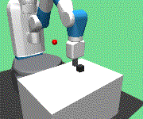
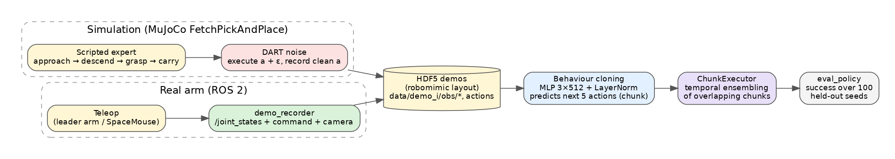
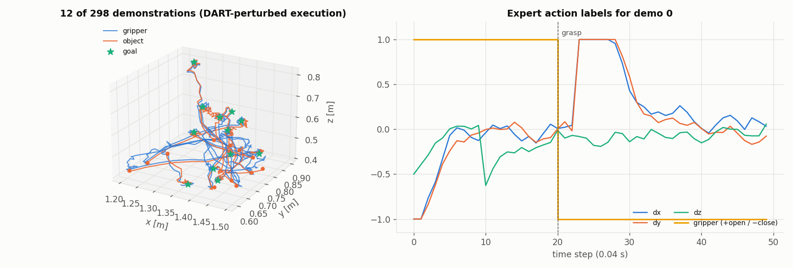
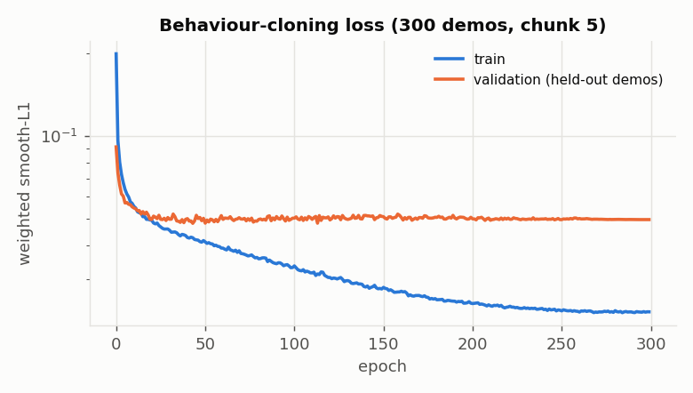
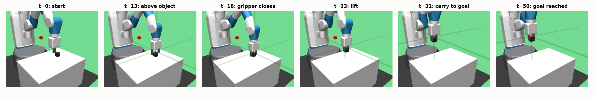
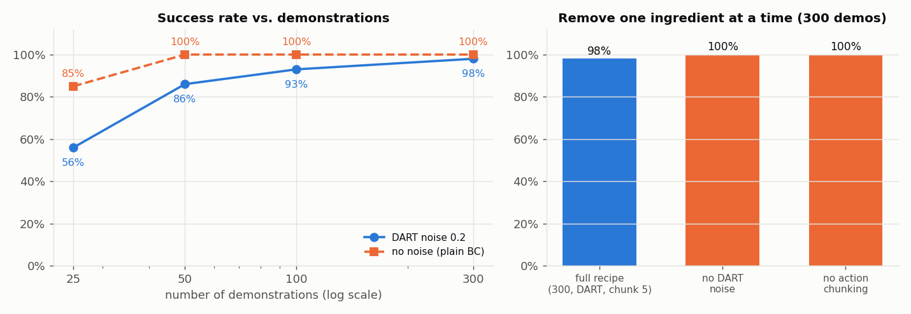
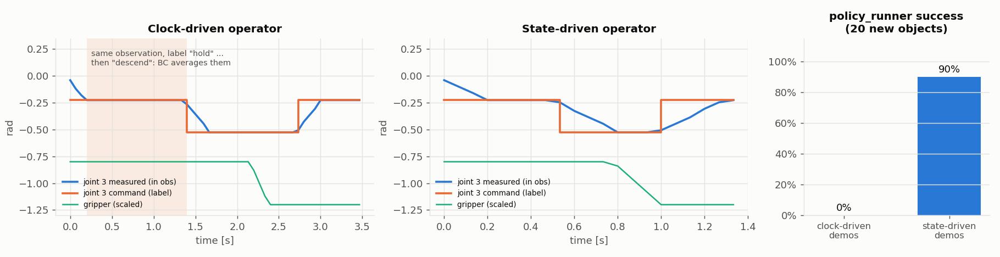

# il_arm — Imitation learning for pick-and-place

Teach a robot arm to pick up a block and move it to a target by **showing it how**:
record demonstrations, train a policy that copies them (behaviour cloning), run the policy.

The pipeline is built and tested twice:

1. **In simulation:** MuJoCo FetchPickAndPlace, with a scripted expert as the demonstrator.
   This shows what makes behaviour cloning work, before any hardware is involved.
2. **Through the real-robot ROS 2 path:** `demo_recorder` → HDF5 → `train_bc` → `policy_runner`,
   run against a stand-in arm. This proves the nodes you will use on hardware work end to end.



*The trained policy (no expert in the loop) on a held-out episode: approach, grasp, carry
the block to the red target in mid-air.*


> Part of my Physical AI project set: [lang_nav](https://github.com/Deivaprakash56/-vlm-language-navigation-ros2) (Language-guided navigation) · [rl_nav](https://github.com/Deivaprakash56/rl-navigation-vs-nav2) (RL navigation benchmarked against Nav2).
> Everything here runs in simulation. The ROS 2 interfaces are the same ones a real robot uses.

## Quick start

Requirements: Ubuntu 22.04, ROS 2 Humble, Python 3.10.

```bash
git clone https://github.com/Deivaprakash56/il_arm.git ~/il_arm && cd ~/il_arm
python3 -m venv --system-site-packages .venv && touch .venv/COLCON_IGNORE
.venv/bin/pip install torch --index-url https://download.pytorch.org/whl/cpu
.venv/bin/pip install "numpy<2" gymnasium gymnasium-robotics "mujoco==3.3.2" h5py matplotlib imageio

source /opt/ros/humble/setup.bash && colcon build --symlink-install
source env.sh                                   # in every new terminal
python -m pytest -q src/il_arm/test
```

Pretrained policies are included (`runs/bc_main/best.pt` for MuJoCo, `runs/bc_fake_arm_state/best.pt` for the ROS fake-arm path), plus the ablation table (`runs/il_ablations.csv`).


---

## Contents

1. [Pipeline](#1-pipeline)
2. [Simulation task and demonstrations](#2-simulation-task-and-demonstrations)
3. [The policy](#3-the-policy)
4. [Results](#4-results)
5. [The real-arm path (ROS 2)](#5-the-real-arm-path-ros-2)
6. [Running it](#6-running-it)
7. [Code map](#7-code-map)
8. [Lessons and next steps](#8-lessons-and-next-steps)

---

## 1. Pipeline



Both demonstration sources write the **same HDF5 layout**, which matches robomimic's, so the
same trainer serves both and the data can also be loaded by robomimic or converted to LeRobot:

```
data.attrs: env, obs_keys, action_dim
data/demo_0/obs/state      (T, D) float32   joint positions [+ object xyz]  |  sim: 31-d Fetch state
data/demo_0/obs/image      (T, H, W, 3)     optional camera
data/demo_0/actions        (T, A) float32
data/demo_0.attrs: success, num_samples
```

---

## 2. Simulation task and demonstrations

**Task:** `FetchPickAndPlace-v4` (Gymnasium-Robotics, MuJoCo). A 7-DoF Fetch arm must grasp a
5 cm block and bring it within 5 cm of a target. The target is on the table or up to 45 cm in
the air. 50 control steps of 0.04 s each.

| | |
|---|---|
| Observation (31-d) | gripper xyz, object xyz, object-relative xyz, finger state, object rotation & velocities (25) + goal xyz (3) + goal − object (3) |
| Action (4-d) | end-effector Δx, Δy, Δz ∈ [−1, 1] (× 5 cm) + gripper (+1 open, −1 close) |

**Expert:** a 4-phase scripted controller (`ScriptedExpert` in `sim.py`) with a proportional
gain toward each phase's target. It succeeds on 100% of 100 test episodes.

```
hover 6 cm above block ─► descend ─► close gripper (4 steps) ─► carry to goal  (re-grasp if dropped)
```

**DART noise injection.** Plain behaviour cloning has a well-known failure mode: the policy
drifts slightly off the expert's path, reaches states the expert never visited, and errors
compound. During collection, the *executed* action gets Gaussian noise (σ = 0.2) added, but the
*recorded* label is the expert's clean action at the perturbed state. The data then contains
"how to recover" examples. (On this task it turned out to *hurt*; see §4.)



*Left: 12 of the 298 demonstrations, gripper (blue) and block (orange) paths. Noise makes the
gripper paths wiggle; the labels stay clean. Right: action labels for one demo, showing the
grasp at step 20 and the carry.*

---

## 3. The policy

```
state (31) ─► normalise ─► [Linear 512 ─ LayerNorm ─ GELU ─ Dropout 0.1] × 3 ─► Linear ─► tanh ─► 5 × 4 actions
```

- **Action chunking (ACT-style).** The network predicts the next *5* actions, not just one.
  At run time each step has up to 5 overlapping predictions for "now", blended with
  exponential weights that favour the older ones (*temporal ensembling*, `ChunkExecutor`).
  This smooths jitter and is how ACT and Diffusion Policy execute.
- **Loss:** smooth-L1 on all predicted actions, with the gripper dimension weighted 2×.
  Getting the open/close timing wrong is the most expensive mistake.
- **Training:** AdamW 1e-3, cosine schedule, 300 epochs, batch 512. Validation uses
  *held-out demonstrations*, not random steps from training demos.



---

## 4. Results

All success rates are measured on **100 episodes with seeds never seen in training**
(`eval_policy.py`, seeds from 100000).

| Policy | Success |
|---|---|
| Scripted expert (upper bound) | 100% |
| BC, 300 demos, DART, chunk 5 (`runs/bc_main`, shown below) | 98% |
| **BC, 300 demos, no noise, chunk 5** | **100%** |



### What matters? (ablations)

Each run gets the same number of gradient steps (`scripts/run_il_ablations.sh`).



| Demos | DART noise σ = 0.2 | No noise (plain BC) |
|---|---|---|
| 25 | 56% | **85%** |
| 50 | 86% (seed 2: 86%) | **100%** (seed 2: 98%) |
| 100 | 93% | **100%** |
| 300 | 98% | **100%** |
| 300, no action chunking (chunk 1) | 100% | – |

100 evaluation episodes per cell, so ±3–5 points is noise. The 50-demo pair was re-run with a
second training seed because the result was surprising, and it held.

**Reading the ablations**

- **Data is the main lever.** With noise injection, going from 25 to 300 demos takes success from
  56% to 98%.
- **DART noise hurt on this task, at every data size.** That contradicts the textbook story, so
  it is worth understanding. The expert is deterministic, fully observed and fast-correcting
  (gain 10), so clean demonstrations already stay near the states the policy will visit, and
  compounding error is small. Noise adds what the loss curves show: validation loss at 50 demos
  is about 0.07 with DART against about 0.005 without. Perturbed states sit near the expert's
  phase thresholds (for example "within 8 mm over the block → descend"), so nearly identical
  states get very different labels. That is the same failure mechanism as the teleop finding
  below, in a milder form. DART earns its keep when the policy's own errors take it far from
  the demonstrations, as with long horizons, partial observability or slow experts. It is
  worth re-testing on real-robot data, not assuming.
- **Action chunking didn't matter in simulation** (chunk 1: 100%). The value of chunking is
  smoothing jittery, inconsistent *human* demonstrations and coping with latency. This scripted
  expert is neither, so the right test for it is on the real arm.

---

## 5. The real-arm path (ROS 2)

Three nodes, chosen to work with any arm that publishes `/joint_states` and accepts
`trajectory_msgs/JointTrajectory` (ros2_control's `joint_trajectory_controller`, MoveIt
setups, most hobby-arm drivers):

| Node | Role |
|---|---|
| `demo_recorder` | samples `/joint_states` + the teleop command (or next state) + optional object pose + optional camera at a fixed rate; Trigger services `~/start`, `~/stop_success`, `~/stop_fail`, `~/discard` |
| `train_bc` | the same trainer as in simulation |
| `policy_runner` | same observation as the recorder → policy → `JointTrajectory`; nothing moves until `~/start`; each step is clamped to `max_joint_step`; it holds position if inputs go stale |

**Why an object pose?** From joint angles alone, a policy cannot know *where* the block is.
It can only replay an average motion. The recorder and runner accept an optional
`object_pose_topic` (AprilTag, colour-blob detector, mocap) and append its xyz to the state.
The camera image is also recorded, for when you move to an image-based policy.

### End-to-end test without hardware

`fake_arm` stands in for the robot. It simulates 3 joints and a gripper with
velocity-limited tracking, and places a random object whose grasp configuration depends on its
position. A scripted teleoperator does the demonstrations. `scripts/run_il_ros_e2e.sh` then
runs the **real** `demo_recorder` and `policy_runner` nodes:

| Step | Result |
|---|---|
| record 40 teleop demos through `demo_recorder` (state = 4 joints + object xyz, 15 Hz) | 40/40 saved |
| `train_bc` (chunk 3, 400 epochs) | 36 train / 4 validation demos |
| `policy_runner` on **20 new object positions** | **18/20 (90%)** |

The first attempt scored **2/20**, and the cause is the most useful lesson in this project.



The first scripted operator was **clock-driven**: "go above the object for 1.4 s, then descend
for 0.8 s, …". The arm reaches the hover pose after about 0.2 s and then sits still. For the
next second, an identical observation is labelled first "hold", then "descend". Behaviour
cloning learns the *average* label for each observation, so the policy holds forever. A
**state-driven** operator (descend as soon as the arm is over the object) gives one label per
observation. Same nodes, same demo count, same training: **0/20 → 18/20**.

Human teleoperators behave like the clock-driven script more often than you'd expect. They
pause, hesitate, or wait for the arm to settle. This is why ACT and Diffusion Policy predict
action *chunks* and condition on short histories. For your own recordings: move with intent,
don't pause mid-task, and use `stop_fail` / `discard` for messy episodes.

Two infrastructure bugs turned up along the way and are fixed:

- `ros2 run` does not forward signals to the node it starts. Killing the wrapper left recorder
  and runner nodes alive, and they answered later runs' service calls (two policies commanding
  one arm). The script now kills the nodes by their install path.
- The recorder kept the HDF5 file open, so training could not read it while recording was
  running. `DemoWriter` now opens the file only while appending a demo, so the file is
  always complete on disk.

---

## 6. Running it

```bash
cd ~/il_arm && source env.sh
export MUJOCO_GL=egl                                   # headless rendering for figures

# simulation
python -m il_arm.eval_policy expert --episodes 100                           # expert sanity check
python -m il_arm.collect_demos --episodes 300 --dart-noise 0.2 --out data/fetch_pick_300.hdf5
python -m il_arm.train_bc data/fetch_pick_300.hdf5 --chunk 5 --epochs 300 --out runs/bc_main
python -m il_arm.eval_policy runs/bc_main/best.pt --episodes 100
python -m il_arm.eval_policy runs/bc_main/best.pt --episodes 3 --render       # MuJoCo viewer

# experiments and figures
scripts/run_il_ablations.sh
python -m il_arm.plot_results ablations runs/il_ablations.csv --out src/il_arm/docs
python -m il_arm.plot_results filmstrip runs/bc_main/best.pt --out src/il_arm/docs

# ROS path against the fake arm
scripts/run_il_ros_e2e.sh 40 20

# on a real arm
ros2 run il_arm demo_recorder --ros-args -p out:=data/real_pick.hdf5 \
    -p joint_names:="[joint1,joint2,joint3,joint4,joint5,joint6,gripper]" \
    -p action_is_next_state:=true -p object_pose_topic:=/object_pose \
    -p image_topic:=/camera/color/image_raw
ros2 service call /demo_recorder/start std_srvs/srv/Trigger
#   ... teleoperate one pick ...
ros2 service call /demo_recorder/stop_success std_srvs/srv/Trigger
python -m il_arm.train_bc data/real_pick.hdf5 --chunk 5 --out runs/bc_real
ros2 run il_arm policy_runner --ros-args -p policy:=runs/bc_real/best.pt \
    -p joint_names:="[joint1,joint2,joint3,joint4,joint5,joint6,gripper]" \
    -p object_pose_topic:=/object_pose -p command_topic:=/arm_controller/joint_trajectory \
    -p max_joint_step:=0.03
ros2 service call /policy_runner/start std_srvs/srv/Trigger
```

Tests: `python -m pytest -q src/il_arm/test` (HDF5 round-trip, chunk padding, executor, save/load).

> MuJoCo is pinned to 3.3.2. Gymnasium-Robotics 1.4.2's joint-type check fails on MuJoCo 3.17.

---

## 7. Code map

```
il_arm/
├── il_arm/
│   ├── sim.py                 # Fetch env factory, observation flattening, ScriptedExpert
│   ├── dataset.py             # DemoWriter / load_demos (HDF5, robomimic layout)
│   ├── collect_demos.py       # expert demos with DART noise
│   ├── bc_policy.py           # BCPolicy (MLP + chunking) and ChunkExecutor (temporal ensembling)
│   ├── train_bc.py            # training loop, held-out-demo validation, loss.csv
│   ├── eval_policy.py         # success rate on unseen seeds (or --render)
│   ├── demo_recorder_node.py  # ROS 2: record teleop demos on a real arm
│   ├── policy_runner_node.py  # ROS 2: run a trained policy on a real arm, with safety clamps
│   ├── fake_arm.py            # ROS 2: stand-in arm + scripted teleop for end-to-end tests
│   └── plot_results.py        # README figures
├── docs/                      # figures
└── test/test_il.py
```

---

## 8. Lessons and next steps

1. **Demonstrations must be consistent with what the policy sees.** The same observation with
   different labels (a clock-driven operator, hesitation, or noise near a decision threshold)
   is averaged into indecision. This showed up twice: 0/20 → 18/20 on the ROS path, and
   DART's slowdown in simulation.
2. **Measure ablations instead of assuming them.** Two standard ingredients (DART, chunking)
   didn't help here. The ablation script makes re-checking them on real data one command.
3. **Validate on held-out demonstrations and unseen seeds.** Random-step validation splits
   leak near-duplicate frames and look far better than they are.
4. **Process hygiene in ROS test harnesses matters.** Stale nodes from a previous run silently
   answered services and doubled the arm's commands. Kill nodes, not wrappers.

**Next steps on hardware**

1. Pick the arm (an SO-100/Koch-style leader–follower pair makes teleop easy) and confirm it
   exposes `/joint_states` + a `JointTrajectory` controller.
2. Add an object pose source (one AprilTag on the block is enough to start).
3. Record 50 demos, train, and run `policy_runner` with `max_joint_step` small (0.02–0.03 rad).
4. Then move to images: a ResNet-18 encoder on `obs/image` with the same chunked head (≈ ACT),
   which removes the need for the tag.
